<div align="center">

[Türkçe](README.md) · **English**

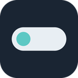

# Ada

**A small island that lives at the top of your Windows screen.**<br>
Follow Claude, control your music, stay focused — without leaving what you're doing.

<br>

<a href="https://github.com/suleymannsahan/SESIsland/releases/latest/download/Ada-Setup.exe">
  
</a>

<br><br>

<a href="https://github.com/suleymannsahan/SESIsland/releases/latest"></a>

<a href="https://github.com/suleymannsahan/SESIsland/releases"></a>
<a href="https://github.com/suleymannsahan/SESIsland/actions/workflows/ci.yml"></a>
<a href="LICENSE"></a>

<br><br>


</div>

<br>

> **SESIsland or Ada?** Same thing. The app is called **Ada** (Turkish for *island*); the repository is called **SESIsland**. The installer, menus and settings all say "Ada".
>
> Ada's interface is in Turkish. The screenshots below show the Turkish UI; labels in this README are translated.

<details>
<summary><b>Contents</b></summary>

- [What is Ada?](#what-is-ada)
- [What it does](#what-it-does)
- [Requirements](#requirements)
- [Install](#install)
- Tabs: [Claude](#-claude) · [Music](#-music) · [Focus](#️-focus) · [Classes](#-classes) · [Tools](#-tools) · [Serial port](#-serial-port) · [System](#-system) · [Shelf](#️-shelf) · [Small touches](#-small-touches)
- [Shortcuts](#shortcuts)
- [Troubleshooting](#troubleshooting)
- [Privacy](#privacy)
- [Development](#development)
- [Thanks](#thanks)

</details>

## What is Ada?

Ada is a thin strip at the top centre of your screen. When nothing is happening it waits as a tiny lighthouse. While Claude works it shows what Claude is doing; while music plays, the song; during a Pomodoro, the time left. Hover over it and it opens sideways; move away and it shrinks again.

<p align="center">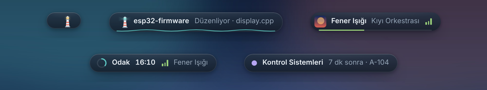</p>

## What it does

| | Tab | In one line |
|---|---|---|
| 🤖 | [Claude](#-claude) | Follow Claude Code / Desktop, approve permissions, answer questions, keep Claude going from the island |
| 🎵 | [Music](#-music) | Spotify and anything playing on Windows: controls, search, add to playlist, synced lyrics, live audio bars |
| ⏱️ | [Focus](#️-focus) | Pomodoro, stopwatch, silence notifications while focusing, daily and weekly summary |
| 📚 | [Classes](#-classes) | Class timetable, exam countdown, Google Calendar events and one-click meeting join |
| 🧮 | [Tools](#-tools) | Engineering calculator, resistor colour code, unit converter, notes, clipboard history |
| 🔌 | [Serial port](#-serial-port) | ESP32 / Arduino output, PASS/FAIL colours, live plot, CSV |
| 📊 | [System](#-system) | CPU, memory, NVIDIA GPU, battery |
| 🗂️ | [Shelf](#️-shelf) | Drop files on the island, drag them out wherever you need them |

## Requirements

| | |
|---|---|
| **OS** | Windows 10 or 11, 64-bit |
| **Claude** | [Claude Code](https://docs.claude.com/en/docs/claude-code/overview) (terminal) and/or Claude Desktop. The Claude tab needs one of them; the other tabs work without Claude |
| **Spotify** *(optional)* | Controlling Spotify from the island needs a **Premium** account (Spotify's rule) and a free, one-time Client ID (5 steps in Settings). Without Premium, the Spotify app still shows up on the island through **music from any app** |
| **GPU info** *(optional)* | An NVIDIA card and driver (`nvidia-smi`) |

Ada has no server and no account; there are no extra programs or drivers to install.

## Install

1. Press **Download for Windows** above and run `Ada-Setup.exe`.
2. The installer isn't code-signed yet, so Windows SmartScreen may warn you: **More info → Run anyway**.
3. On first launch Ada adds its Claude Code hooks to `~/.claude/settings.json` (the old file is kept as a dated backup). Start a new Claude Code session.
4. For **Spotify**, follow the 5 steps in Ada's Settings window (once, about 2 minutes).

Ada tells you on the island when a new version is out.

## 🤖 Claude

Follow Claude Code and Claude Desktop from the island. Approve permission requests without switching to the terminal or window, answer multiple-choice questions with one click, and hear when the job is done. Your usage limit is shown at the top.

<p align="center">
  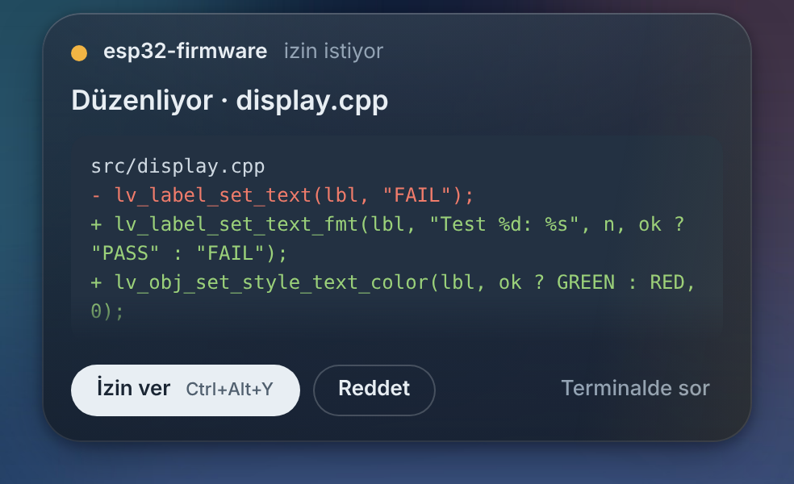
  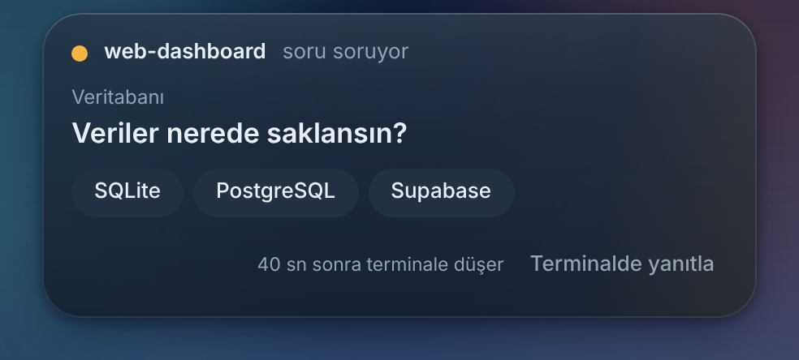
</p>
<p align="center">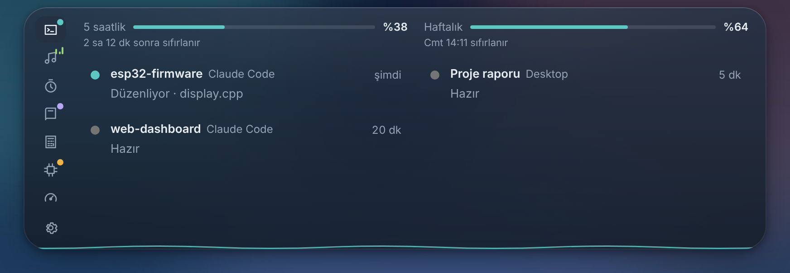</p>

**Reply from the island:** when Claude Code finishes, the card offers **Continue**, **Test it**, **Explain**, **Commit** and a text box; what you type goes to Claude, which keeps working without you going back to the terminal. With several sessions running, the collapsed island shows them side by side, and the session list shows each one's last message.

<p align="center">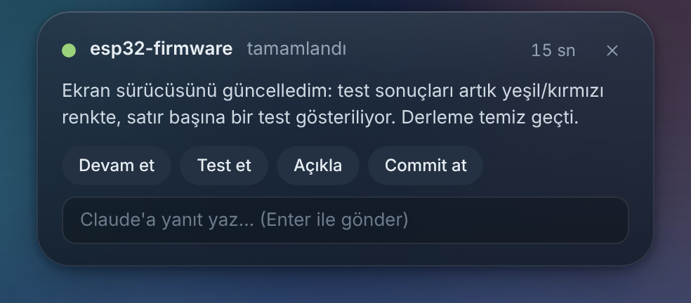</p>

## 🎵 Music

Control Spotify from the island: cover, progress, play/pause, shuffle, repeat, like, **add the current song to a playlist**, **search and play**, switch device. Synced lyrics scroll with the song, with an optional Turkish translation. If Spotify is closed, Ada opens it and then plays. The volume slider is the computer's master volume.

<p align="center">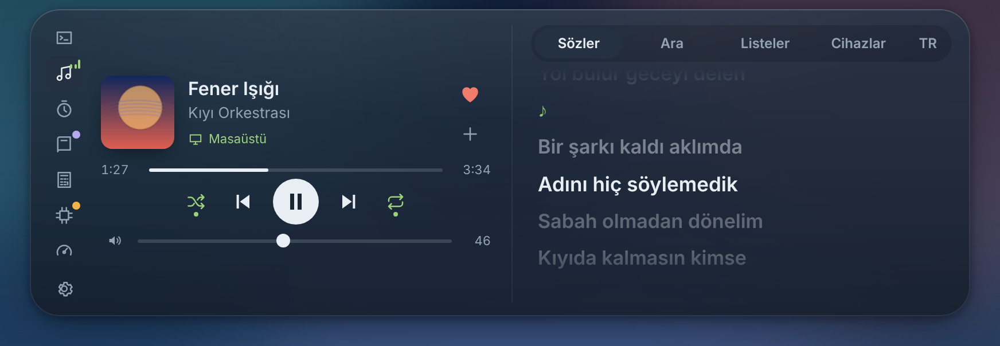</p>
<p align="center">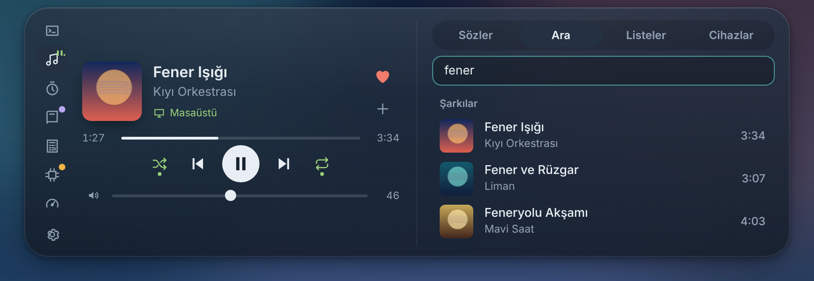</p>

**Music from any app:** YouTube (in the browser), VLC, Media Player or the Spotify app without the API… anything that reaches Windows' media controls appears on the island and can be controlled from there, lyrics included. With more than one source, pick one under **Sources**. The bars move with the actual sound coming out of the computer, and the island takes on the album cover's colour.

<p align="center">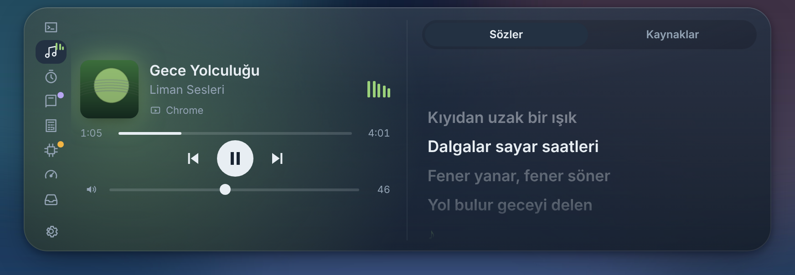</p>

## ⏱️ Focus

Pomodoro ring, presets (25/5, 50/10, 15/3), music when focus starts, pause on breaks, notifications silenced during focus. Summary of today and the last 7 days.

<p align="center">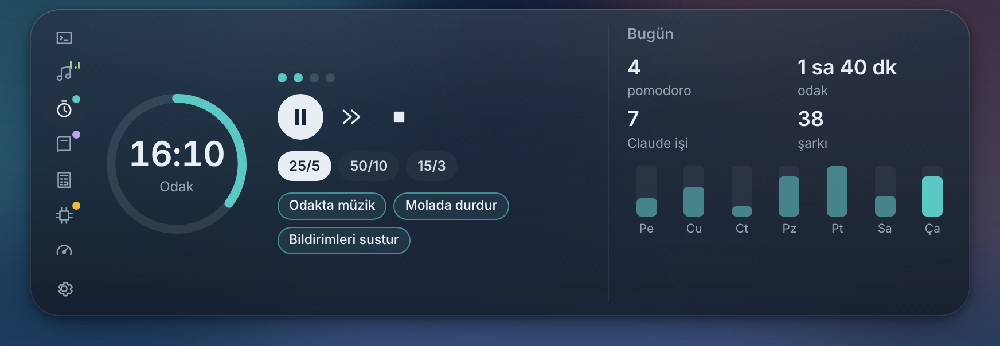</p>

**Stopwatch:** switch from Pomodoro to Stopwatch on the Focus tab and it counts up from zero. Take laps, pause and reset; the elapsed time is added to today's focus time. It keeps counting while the island is hidden.

<p align="center">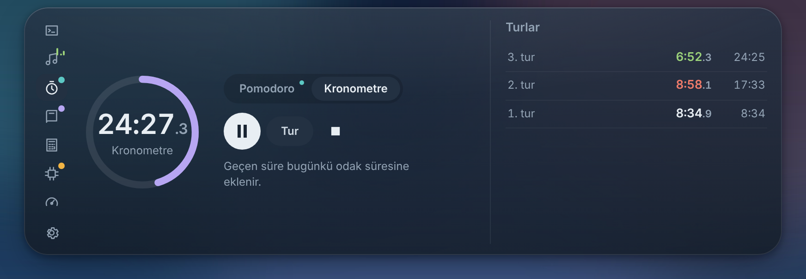</p>

## 📚 Classes

Today's classes (now / next), days left until exams, and a reminder a few minutes before class. Connect your **Google Calendar** (with its iCal address) and events appear in the same list; the island lets you know before they start, and if there's a Meet / Zoom / Teams link, just press **Join**.

<p align="center">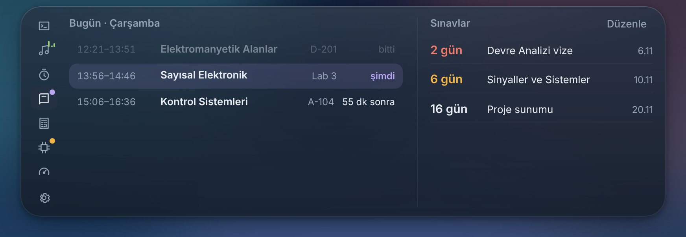</p>

## 🧮 Tools

Engineering calculator (`4.7k*2`, `1k||2.2k`, `12V/220`, `1/(2pi*50Hz*100nF)`), quick notes and clipboard history. Clipboard history is never written to disk.

- **Resistor colour code:** click the bands to pick colours, or type a value (`4k7`, `220`, `1M`); 4 and 5 bands, nearest E24 value.
- **Convert:** `20dBm` → 100 mW, `22AWG` → diameter/area/resistance, `1kHz` → period, `100nF` → capacitor code (104), `10mil` → mm, `25C` → °F, and nearest E12/E24/E96 values.

<p align="center">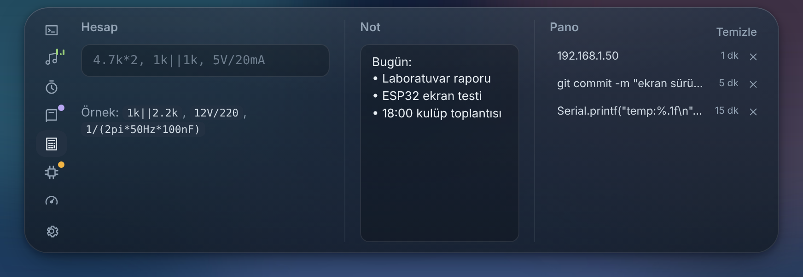</p>
<p align="center">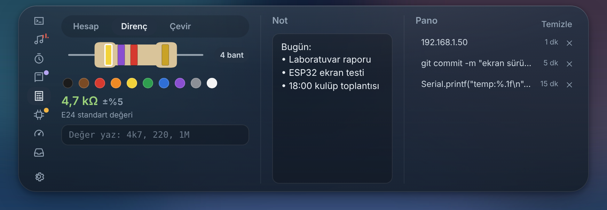</p>

## 🔌 Serial port

Read ESP32 / Arduino output on the island. Lines containing `PASS` turn green, `FAIL` red; numbers in the lines (`temp:41.2`) become a live plot. Freeze the plot, choose the last 120/300/600 samples, hover to read values, hide series and save as **CSV** to the desktop. No drivers or extra modules needed.

<p align="center">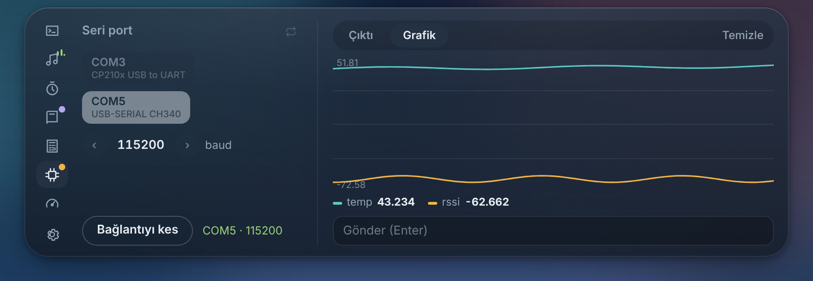</p>

## 📊 System

CPU, memory, NVIDIA GPU temperature and load, battery, uptime.

<p align="center">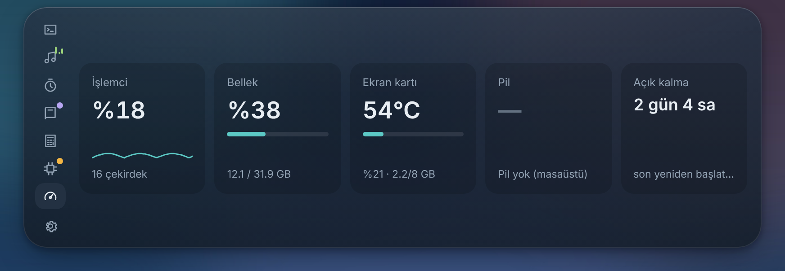</p>

## 🗂️ Shelf

Drag files onto the island and Ada keeps them on the shelf. Later, drag them from here into any folder, a browser upload box or a message. Double-click to open, drag one at a time or all at once. Files aren't copied; Ada only remembers where they are.

<p align="center">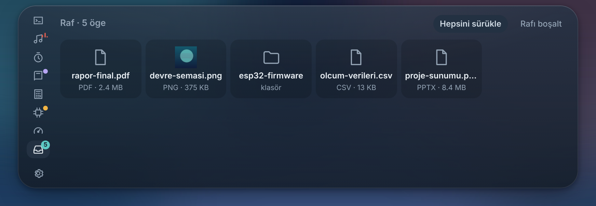</p>

## ✨ Small touches

- **Camera / microphone dot:** a green dot while an app uses the camera, orange for the microphone (hover to see which app).
- **Devices:** a short card when Bluetooth headphones connect (with battery level if Windows knows it), when the charger is plugged in or out, and when the battery drops to 20%, 10% and 5%.
- **Event animations:** a light ring and glow when a job is done, confetti when a Pomodoro ends, an amber pulse while a permission is waiting.
- **Theme:** midnight blue or pure black island, 7 accent colours or Windows' own accent, Compact / Normal / Large size.
- **Lighthouse:** stars and a moon at night, the sun rises in the morning, it sweats the day before an exam and puffs "z"s while asleep.

## Shortcuts

| Shortcut | |
|---|---|
| `Ctrl` `Alt` `Space` | Play / pause |
| `Ctrl` `Alt` `→` / `←` | Next / previous song |
| `Ctrl` `Alt` `↑` / `↓` | Computer volume ±5 |
| `Ctrl` `Alt` `M` | Mute / unmute |
| `Ctrl` `Alt` `Y` / `N` | Claude: allow / deny |
| `Ctrl` `Alt` `P` | Start / pause Pomodoro |
| `Ctrl` `Alt` `K` | Start / pause stopwatch |
| `Ctrl` `Alt` `A` | Open the island |

With the pointer over the island: the **wheel** changes volume, **horizontal scroll** (or `Shift` + wheel) changes song.

## Troubleshooting

Tray menu items are in Turkish; the English meaning is given in brackets.

<details>
<summary><b>No card on the island when Claude asks for permission</b></summary>

1. After opening Ada, start a **new session** in Claude Code; sessions that were already open use the old settings.
2. Right-click the tray icon: if it says **Claude Code hook'larını kur** (install hooks), press it. If it says *kaldır* (remove), they are installed.
3. Make sure only one Ada is running. If you see "Port 47821 kullanımda" (port in use), close the other Ada in the tray.
4. Tray → **Sorun giderme → Test bildirimi** (Troubleshooting → Test notification) to check that the island reacts.
5. For Claude Desktop, **Claude Desktop sohbetini izle (deneysel)** (watch Claude Desktop, experimental) must be on in the tray.

</details>

<details>
<summary><b>Spotify won't connect</b></summary>

- The **Redirect URI** in the Spotify developer dashboard must match the one in Settings exactly (`http://127.0.0.1:47822/callback`). `localhost` does not work.
- **Web API** must be ticked when creating the app.
- "Bu kontrol için Spotify Premium gerekiyor" (Premium required) comes from Spotify: play/pause, skip and similar controls need Premium. Without Premium the song still shows on the island through **music from any app**.
- If nothing is playing, start a song in Spotify; that's how the island finds the active device.
- **Yeniden bağlan** (reconnect) in Settings refreshes the permission in the browser.

</details>

<details>
<summary><b>Windows SmartScreen says "Windows protected your PC"</b></summary>

The installer isn't code-signed yet. Press **More info → Run anyway**. You can check that the file came from this repository by comparing its name with the Releases page.

</details>

<details>
<summary><b>Ada disappears during fullscreen games or videos</b></summary>

That's on purpose: with a fullscreen app in front, the island steps aside, and it still appears if Claude is waiting for permission. Turn it off with **Tam ekran uygulamalarda gizlen** (hide in fullscreen apps) in Settings.

</details>

<details>
<summary><b>Diagnostic report: what to attach when reporting a problem?</b></summary>

Right-click the tray icon → **Sorun giderme → Tanı raporu oluştur** (Troubleshooting → Create diagnostic report). `ada-tani.txt` is written to your desktop with the version, window state and recent events (no passwords or Spotify keys). Attach it to a [bug report](https://github.com/suleymannsahan/SESIsland/issues/new?template=hata.yml).

For Claude Desktop issues, **Desktop tanılama dosyası oluştur** (`ada-tanilama.txt`) in the same menu also helps.

</details>

## Privacy

- Ada has no server, asks for no account and sends no usage data.
- Claude hooks only talk inside your computer (`127.0.0.1`).
- The Spotify sign-in token is kept in Windows' encrypted store; your password never reaches Ada.
- The usage limit is asked only of `api.anthropic.com`, with the login Claude Code saved on this computer.
- Clipboard history is never written to disk.
- For the audio bars, the computer's sound is only listened to in the moment; nothing is recorded or sent.
- The calendar is read directly from the iCal address you give; events are kept in memory only.
- Other network requests: `lrclib.net` for lyrics, `mymemory.translated.net` if translation is on, `api.github.com` for update checks.

## Development

```bash
npm install
npm start          # run in development mode
npm test           # unit tests (also run on Linux / macOS)
npm run dist       # Windows installer + zip (needs Wine on Linux)
```

GitHub Actions runs the tests on every push. A version tag (`git tag v0.6.0 && git push origin v0.6.0`) builds the installer, attaches it to Releases and fills the release notes from [`CHANGELOG.md`](CHANGELOG.md). To contribute: [`CONTRIBUTING.md`](CONTRIBUTING.md).

<details>
<summary>Project structure</summary>

```
src/main.js              main process: window, tray, shortcuts, modules
src/preload.js           bridge between the UI and the main process
src/server.js            Claude Code hook server (127.0.0.1:47821)
src/hooks.js             ~/.claude/settings.json setup
src/describe.js          turns tool calls into short labels
src/desktop-watcher.js   Claude Desktop watcher (UI Automation)
src/usage.js             Claude usage limit (5-hour / weekly)
src/spotify.js           Spotify Web API (PKCE)
src/media.js             Windows media sessions (YouTube, VLC, Media Player…)
src/lyrics.js            LRCLIB lyrics + translation
src/volume.js            Windows master volume
src/pomodoro.js          Pomodoro      src/stopwatch.js  stopwatch
src/stats.js             daily summary src/store.js      small JSON store
src/calendar.js          Google Calendar (iCal) and recurring events
src/clip.js              clipboard history (memory only)
src/shelf.js             file shelf
src/serial.js            serial port monitor
src/system.js            CPU, memory, NVIDIA GPU
src/winctl.js            fullscreen detection, bring window to front
src/updater.js           version check against GitHub Releases
src/renderer/            island UI: core.js + tab-*.js, viz.js (audio bars),
                         devices.js (device cards), calc.js, electronics.js, settings
scripts/*.ps1            Windows helpers: UI Automation, media, volume, serial port,
                         camera/microphone (privacy), Bluetooth battery, window
test/                    unit tests (node --test)
```
</details>

## Thanks

- [twocode.nl](https://twocode.nl) — for the inspiration.
- [LRCLIB](https://lrclib.net) — free, community-run synced lyrics.
- [MyMemory](https://mymemory.translated.net) — lyrics translation.
- [Electron](https://www.electronjs.org) and [electron-builder](https://www.electron.build).

<br>

<div align="center">

MIT · Süleyman Emre Şahan

<sub>Songs, projects and classes in the screenshots are examples.</sub>

</div>
