<div align="center">

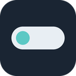

# Ada

**Windows için ekranın üstünde yaşayan küçük bir ada.**<br>
Claude'u takip et, müziğini yönet, odaklan — yaptığın işi bırakmadan.

<br>

<a href="https://github.com/suleymannsahan/SESIsland/releases/latest/download/Ada-Setup.exe">
  
</a>

<br><br>

<a href="https://github.com/suleymannsahan/SESIsland/releases/latest"></a>

<a href="LICENSE"></a>

<br><br>


</div>

<br>

## Ada nedir?

Ada, ekranının üst ortasında duran ince bir şerittir. Bir şey olmadığında küçük bir deniz feneri olarak bekler. Claude çalışırken ne yaptığını, müzik çalarken şarkıyı, Pomodoro'dayken kalan süreyi gösterir. Üzerine gelince yana doğru açılır; uzaklaşınca yine küçülür.

<p align="center">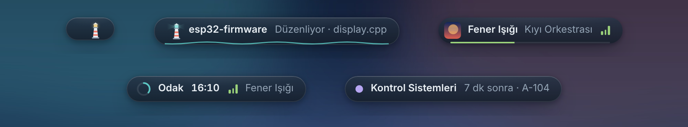</p>

<br>

## 🤖 Claude

Claude Code ve Claude Desktop'ı adadan takip et. İzin isteklerini terminale ya da pencereye geçmeden onayla, seçenekli soruları tek tıkla yanıtla, iş bitince sesli haber al. Kullanım limitin de üstte görünür.

<p align="center">
  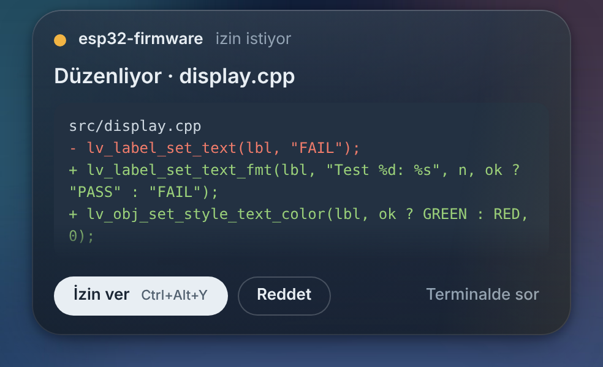
  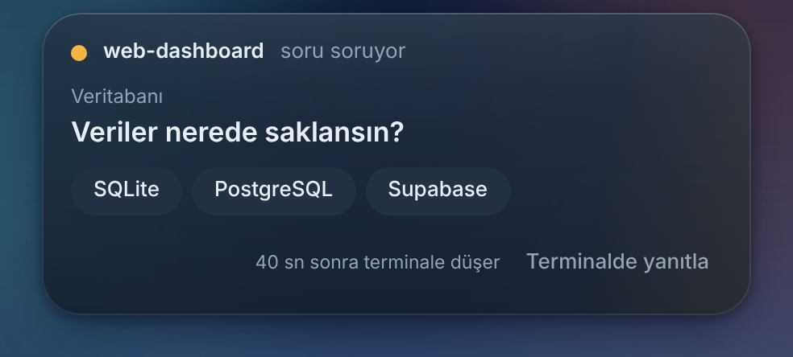
</p>
<p align="center">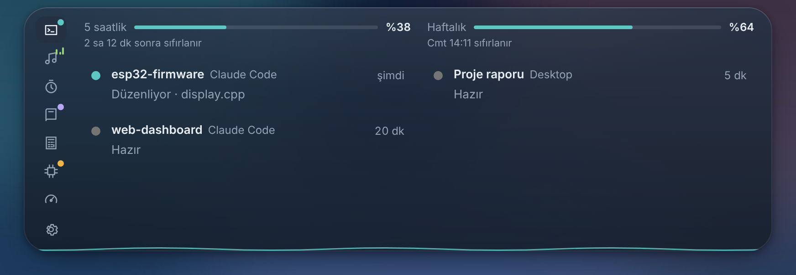</p>

**Adadan yanıt ver:** Claude Code bir işi bitirince kartta **Devam et**, **Test et**, **Açıkla**, **Commit at** düğmeleri ve bir yazı kutusu çıkar; yazdığın şey Claude'a iletilir, terminale dönmeden çalışmaya devam eder. Aynı anda birkaç oturum çalışıyorsa toplanmış ada hepsini yan yana gösterir; oturum listesinde her birinin son mesajı okunur.

<p align="center">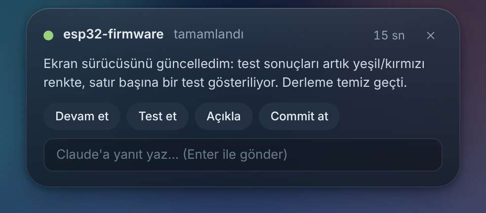</p>

## 🎵 Müzik

Spotify'ı adadan yönet: kapak, ilerleme, oynat/duraklat, karıştır, tekrar, beğen, **çalan şarkıyı playliste ekle**, **ara ve çal**, cihaz değiştir. Şarkıyla birlikte kayan senkronize sözler ve isteğe bağlı Türkçe çeviri. Spotify kapalıysa Ada açar, sonra çalar. Ses sürgüsü bilgisayarın genel sesidir.

<p align="center">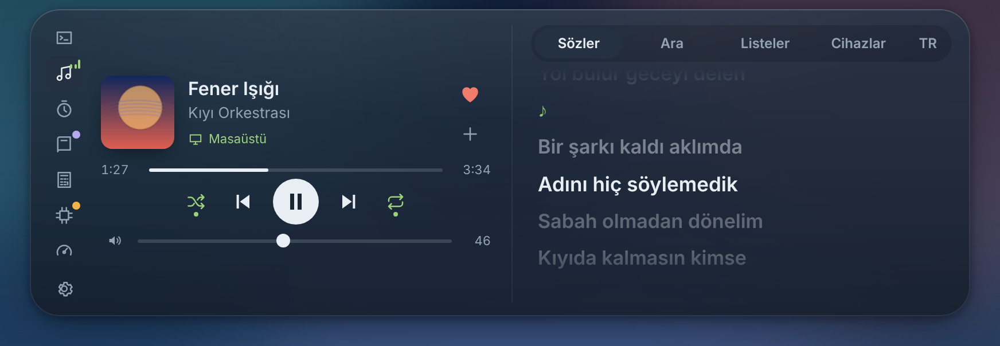</p>
<p align="center">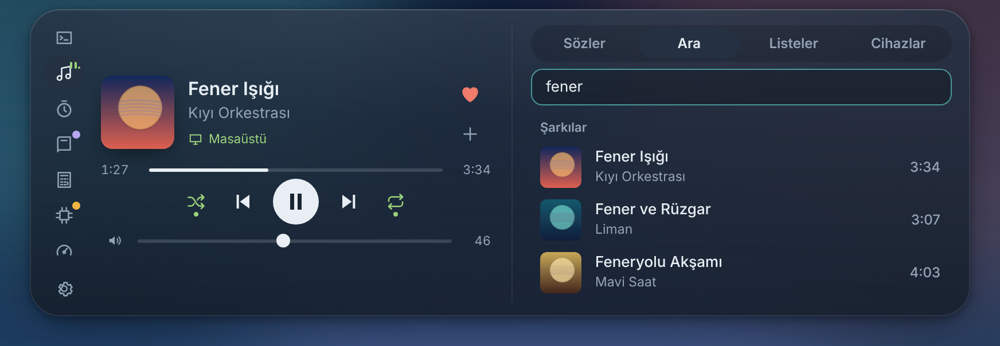</p>

**Her uygulamanın müziği:** YouTube (tarayıcıda), VLC, Medya Oynatıcı ya da API'siz Spotify uygulaması… Windows'un medya kontrolüne düşen her şey adada görünür ve oradan yönetilir; sözler de gelir. Birden fazla kaynak varsa **Kaynaklar**'dan seçersin. Çubuklar bilgisayardan çıkan gerçek sese göre oynar, ada albüm kapağının rengini alır.

<p align="center">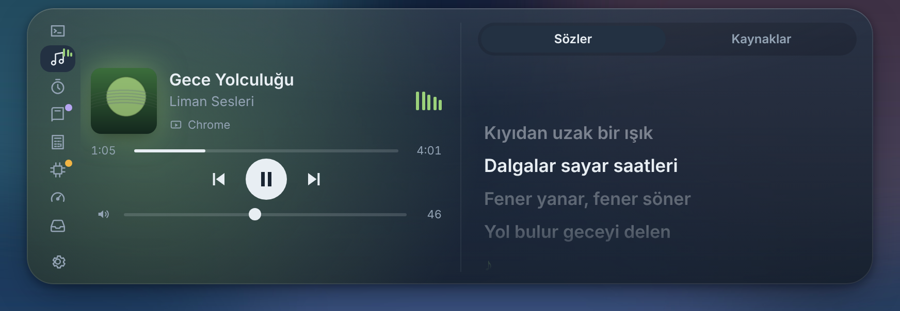</p>

## ⏱️ Odak

Pomodoro halkası, hazır süreler (25/5, 50/10, 15/3), odak başlayınca müzik, molada duraklatma, odak sırasında bildirimleri susturma. Bugünün ve son 7 günün özeti.

<p align="center">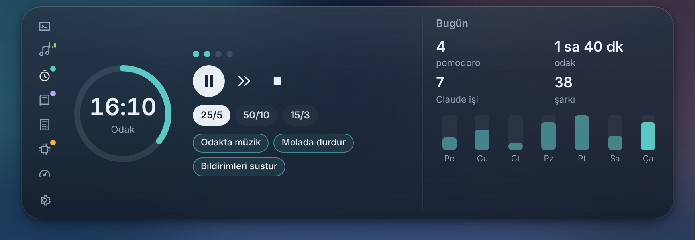</p>

**Kronometre:** Odak sekmesinde Pomodoro yerine Kronometre'ye geçersen süre sıfırdan saymaya başlar. Tur alabilir, duraklatıp sıfırlayabilirsin; geçen süre bugünkü odak süresine eklenir. Ada gizliyken de saymaya devam eder.

<p align="center">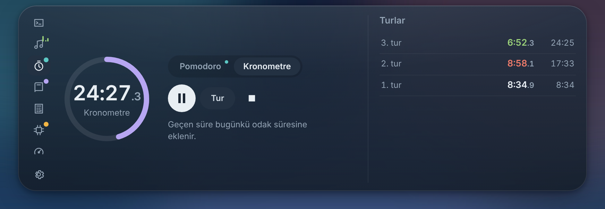</p>

## 📚 Ders

Bugünkü dersler (şimdi / sıradaki), sınavlara kalan gün ve dersten birkaç dakika önce hatırlatma. **Google Takvim**'ini (iCal adresiyle) bağlarsan etkinlikler derslerle aynı listede görünür, başlamadan önce ada haber verir; Meet / Zoom / Teams linki varsa **Katıl**'a basman yeter.

<p align="center">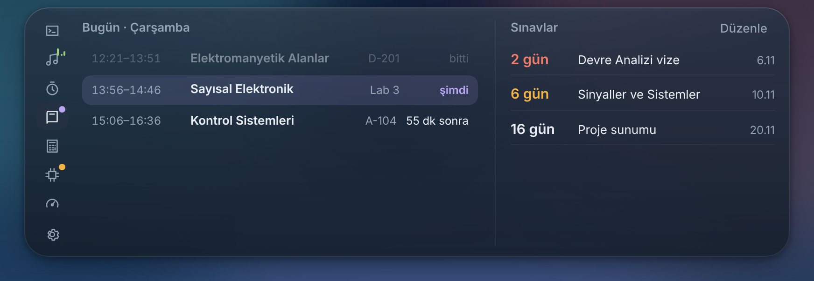</p>

## 🧮 Araçlar

Mühendislik hesap makinesi (`4.7k*2`, `1k||2.2k`, `12V/220`, `1/(2pi*50Hz*100nF)`), hızlı not ve pano geçmişi. Pano geçmişi diske yazılmaz.

- **Direnç renk kodu:** bantlara tıklayıp renk seç ya da değeri yaz (`4k7`, `220`, `1M`); 4 ve 5 bant, en yakın E24 değeri.
- **Çevir:** `20dBm` → 100 mW, `22AWG` → çap/kesit/direnç, `1kHz` → periyot, `100nF` → kondansatör kodu (104), `10mil` → mm, `25C` → °F, ve E12/E24/E96 en yakın değerler.

<p align="center">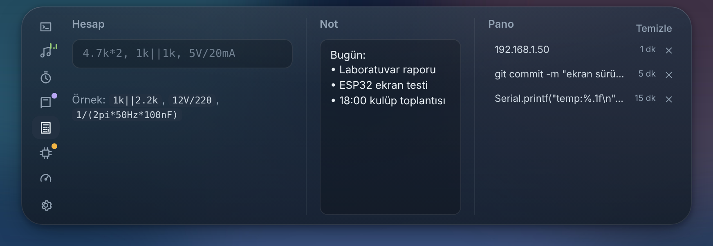</p>
<p align="center">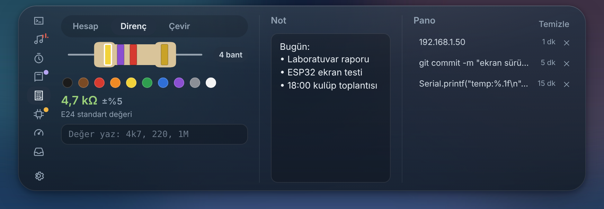</p>

## 🔌 Seri port

ESP32 / Arduino çıktısını adada oku. `PASS` geçen satırlar yeşil, `FAIL` geçenler kırmızı; satırlardaki sayılar (`temp:41.2`) canlı grafiğe dönüşür. Grafiği dondurabilir, son 120/300/600 ölçümü seçebilir, fareyle üstünde gezip değer okuyabilir, serileri gizleyebilir ve **CSV** olarak masaüstüne kaydedebilirsin. Sürücü ya da ek modül gerekmez.

<p align="center">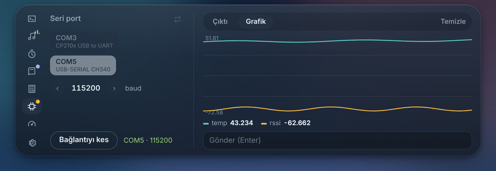</p>

## 📊 Sistem

İşlemci, bellek, NVIDIA ekran kartı sıcaklığı ve yükü, pil, açık kalma süresi.

<p align="center">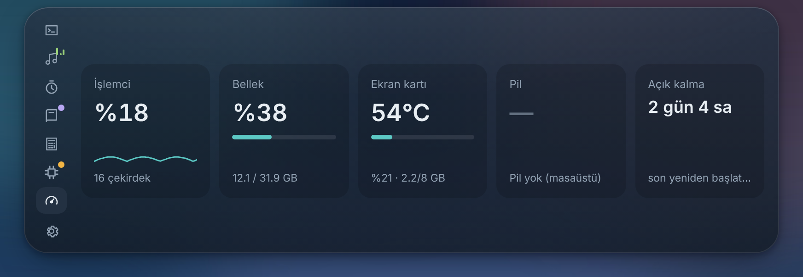</p>

## 🗂️ Raf

Dosyaları adanın üstüne sürükleyip bırak; Ada onları rafta tutar. Sonra buradan istediğin klasöre, tarayıcıdaki yükleme kutusuna ya da bir mesaja sürüklersin. Çift tıkla aç, tek tek ya da hepsini birden sürükle. Dosyalar kopyalanmaz, Ada sadece yerlerini hatırlar.

<p align="center">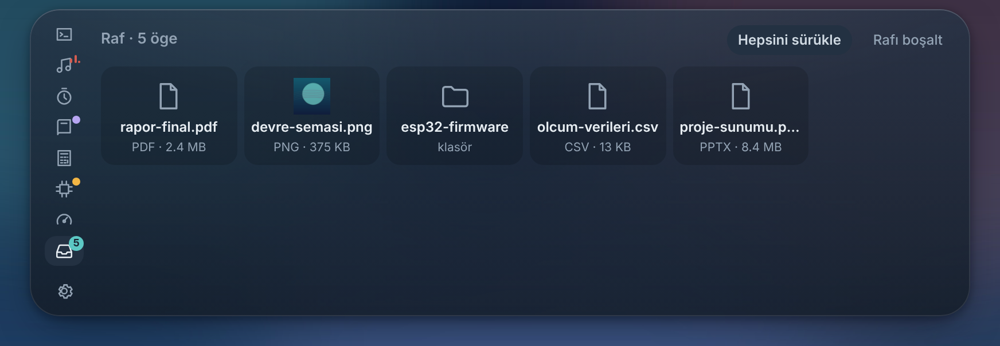</p>

## ✨ Küçük dokunuşlar

- **Kamera / mikrofon noktası:** bir uygulama kamerayı kullanırken yeşil, mikrofonu kullanırken turuncu nokta yanar (üstüne gelince hangi uygulama olduğu yazar).
- **Cihazlar:** Bluetooth kulaklık bağlanınca (Windows biliyorsa pil yüzdesiyle), şarj takılınca/çıkınca ve pil %20, %10, %5'e düşünce kısa bir kart.
- **Olay animasyonları:** iş bitince ışık halkası ve parlama, Pomodoro bitince konfeti, izin beklerken amber nabız.
- **Tema:** gece mavisi ya da tamamen siyah ada, 7 vurgu rengi ya da Windows'un kendi rengi, Kompakt / Normal / Büyük boyut.
- **Fener:** gece yıldızlar ve ay, sabah güneş doğar, sınavdan önceki gün terler, uyurken "z" çıkarır.

<br>

## Kısayollar

| Kısayol | |
|---|---|
| `Ctrl` `Alt` `Boşluk` | Oynat / duraklat |
| `Ctrl` `Alt` `→` / `←` | Sonraki / önceki şarkı |
| `Ctrl` `Alt` `↑` / `↓` | Bilgisayar sesi ±5 |
| `Ctrl` `Alt` `M` | Sesi kapat / aç |
| `Ctrl` `Alt` `Y` / `N` | Claude: izin ver / reddet |
| `Ctrl` `Alt` `P` | Pomodoro başlat / duraklat |
| `Ctrl` `Alt` `K` | Kronometre başlat / duraklat |
| `Ctrl` `Alt` `A` | Adayı aç |

Fare adanın üstündeyken: **tekerlek** sesi değiştirir, **yana kaydırma** (ya da `Shift` + tekerlek) şarkı değiştirir.

## Kurulum

1. Yukarıdaki **Windows için indir** düğmesine bas ve `Ada-Setup.exe`'yi çalıştır.
2. Kurulum dosyası imzalı olmadığı için Windows SmartScreen uyarı verebilir: **Ek bilgi → Yine de çalıştır**.
3. İlk açılışta Ada, Claude Code hook'larını `~/.claude/settings.json`'a ekler (eski dosya tarihli bir yedekle saklanır). Claude Code'da yeni bir oturum başlat.
4. **Spotify** için Ada'nın Ayarlar penceresindeki 5 adımı izle (bir kere, yaklaşık 2 dakika). Spotify'ın kuralları gereği hesap sahibinin Premium olması gerekir.

Yeni sürümler çıktığında Ada adada haber verir.

## Gizlilik

- Ada'nın sunucusu yok, hesap istemez, kullanım verisi göndermez.
- Claude hook'ları yalnızca bilgisayarının içinde (`127.0.0.1`) konuşur.
- Spotify giriş anahtarı Windows'un şifreli deposunda saklanır; şifren Ada'ya hiç gelmez.
- Kullanım limiti, Claude Code'un bu bilgisayara kaydettiği girişle yalnızca `api.anthropic.com`'a sorulur.
- Pano geçmişi diske yazılmaz.
- Ses çubukları için bilgisayarın sesi yalnızca anlık olarak dinlenir; hiçbir şey kaydedilmez ya da gönderilmez.
- Takvim, verdiğin iCal adresinden doğrudan okunur; etkinlikler sadece bellekte tutulur.
- Ağa çıkan diğer istekler: şarkı sözleri için `lrclib.net`, çeviri açıksa `mymemory.translated.net`, güncelleme kontrolü için `api.github.com`.

## Geliştirme

```bash
npm install
npm start          # geliştirme modunda çalıştır
npm run dist       # Windows kurulum dosyası + zip (Linux'ta Wine gerekir)
```

Bir sürüm etiketi (`git tag v0.5.0 && git push origin v0.5.0`) GitHub Actions'ta kurulum dosyasını derler ve Releases'e ekler.

<details>
<summary>Proje yapısı</summary>

```
src/main.js            ana süreç: pencere, tray, kısayollar, modüller
src/server.js          Claude Code hook sunucusu (127.0.0.1:47821)
src/hooks.js           ~/.claude/settings.json kurulumu
src/desktop-watcher.js Claude Desktop izleyici (UI Automation)
src/spotify.js         Spotify Web API (PKCE)
src/lyrics.js          LRCLIB sözleri + çeviri
src/volume.js          Windows ana ses
src/pomodoro.js …      pomodoro, istatistik, sistem, pano, seri port, kullanım, güncelleme
src/renderer/          ada arayüzü (core.js + tab-*.js) ve ayarlar penceresi
scripts/*.ps1          Windows yardımcıları (UI Automation, seri port, ses, pencere)
```
</details>

<br>

<div align="center">

MIT · Süleyman Emre Şahan

<sub>Ekran görüntülerindeki şarkılar, projeler ve dersler örnektir.</sub>

</div>
